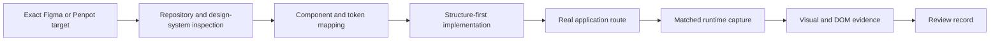

# Design to Runtime

**Figma or Penpot → existing frontend stack → verified running UI.**

[简体中文](README.zh-CN.md)

Design to Runtime is an open-source Codex skill for frontend engineers who want design-to-code work to end in a real, reviewable application state. It combines provider-aware design inspection, component and token reuse, responsive implementation, runtime screenshots, DOM geometry, and layered quality evidence.

It works with React, Vue, Svelte, Angular, plain HTML/CSS, and other stacks because it adapts to the repository instead of generating a replacement project.

## Why engineers use it

- Supports both Figma and Penpot through provider adapters.
- Reuses the project's components, tokens, icons, routes, and commands.
- Builds layout structure before tuning visual detail.
- Verifies the actual route after data, redirects, and fonts settle.
- Checks screenshot dimensions deterministically without treating a pixel score as truth.
- Resolves disputed offsets with original-resolution crops and DOM measurements.
- Keeps visual, responsive, interaction, accessibility, automation, and human acceptance evidence separate.
- Works from an exported PNG reference when MCP is unavailable; SVG remains usable as an implementation asset.

## Workflow



## Install

Ask Codex to install the skill from this repository:

```text
$skill-installer Install the skill from https://github.com/wangcheng825/design-to-runtime
```

For repository-scoped use, copy this folder to:

```text
<repo>/.agents/skills/design-to-runtime/
```

For user-scoped use, place it under:

```text
~/.agents/skills/design-to-runtime/
```

Codex detects local skill changes automatically in most cases. Restart Codex if it does not appear.

## Use

Invoke the skill explicitly for an important screen:

```text
$design-to-runtime Implement the linked Penpot dashboard in the existing app at /dashboard.
Use the current component library and tokens. Verify 1440x900 and 390x844,
capture the real route, and report visual, responsive, interaction, and accessibility evidence separately.
```

The minimum useful inputs are:

- an exact Figma frame/layer or Penpot page/board/shape;
- the target route and viewport;
- required data and UI state;
- the allowed code scope;
- repository-confirmed run and validation commands, when they are not discoverable from the project.

Provider MCP tools are recommended, but an exported PNG reference is supported with documented limitations. SVG can be used for implementation assets, but authoritative screenshot comparison requires a deterministic PNG at the target viewport and device scale. Design-file writes are outside the default code-implementation flow and happen only when the request includes them.

## Deterministic helpers

Check that two authoritative PNGs have identical dimensions:

```bash
node scripts/verify-png-pair.mjs reference.png runtime.png
```

Create a review record:

```bash
node scripts/create-review-record.mjs \
  --provider penpot \
  --design-ref "file/page/board" \
  --target-id "board-id" \
  --runtime-url "http://localhost:3000/dashboard" \
  --viewport 1440x900 \
  --device-scale 1 \
  --reference-image reference.png \
  --runtime-image runtime.png \
  --output design-runtime-review.json
```

The helpers use Node.js built-ins and install no runtime dependencies.

## Validate this repository

```bash
npm test
npm run validate
```

The CI workflow runs the same checks on Node.js 20 and 22.

## Scope

This skill is designed for implementation, fidelity correction, and visual QA against a concrete reference. Product discovery and open-ended visual ideation should establish a design direction first, then use this skill for implementation and runtime verification.

## Inspirations

- [kentLin0/front-UI-check](https://github.com/kentLin0/front-UI-check) inspired the emphasis on authoritative captures, direct visual review, and evidence-backed disputed findings.
- [Penpot](https://github.com/penpot/penpot) inspired the open, code-oriented design workflow, Flex/Grid mapping, design tokens, and bidirectional MCP workflows.

See [THIRD_PARTY_NOTICES.md](THIRD_PARTY_NOTICES.md) for attribution.

## Security

Figma and Penpot MCP tools may be able to write to design files. The skill uses design reads for code implementation by default and follows the user's explicit scope for any design changes. Never commit MCP URLs containing tokens, cookies, private design exports, or production credentials.

## License

MIT. See [LICENSE](LICENSE).
